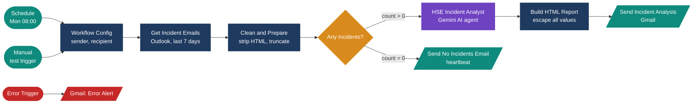
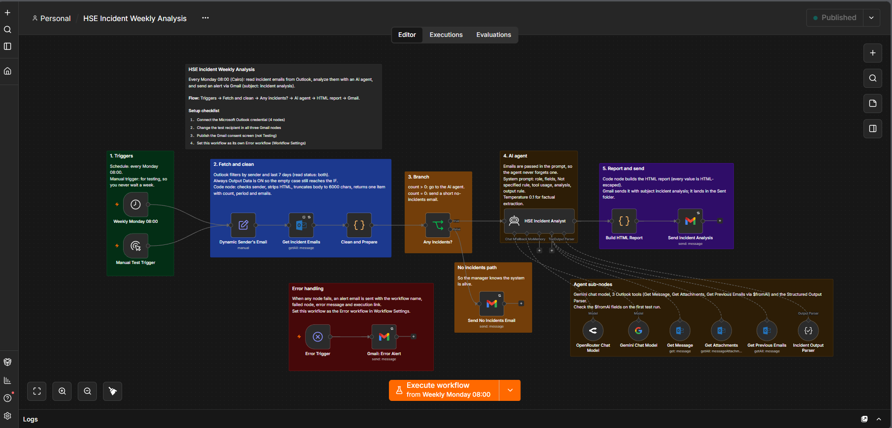
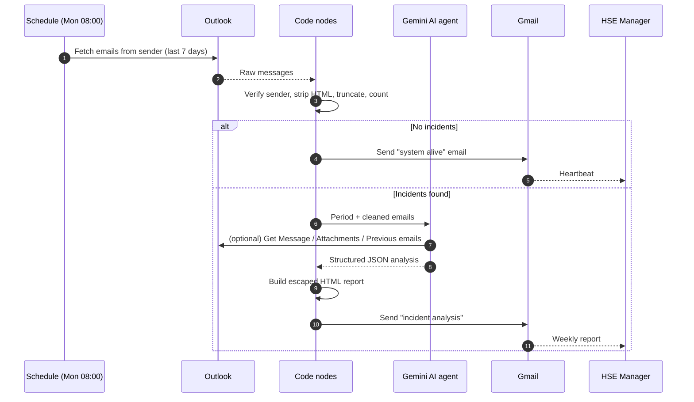
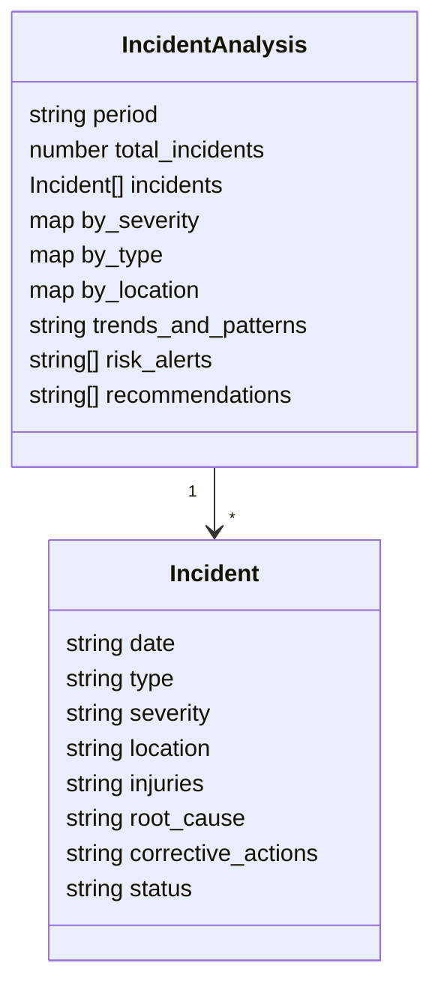

<p align="center">
  
</p>

<p align="center">
  
  
  
  
  
</p>

# HSE Incident Weekly Analysis

An **n8n workflow** that gives a container terminal's Health, Safety & Environment (HSE) department a weekly executive briefing, without anyone reading hundreds of incident emails by hand.

Every Monday at 08:00 (Cairo time) it reads the last 7 days of incident notification emails from Outlook, uses an **AI agent (Google Gemini)** to extract and analyze the incidents, and sends a formatted **HTML report** by Gmail.

> Built by **Team 1 (AI Automation & Agentic AI Track)** as part of the **Digital Egypt Pioneers Initiative (DEPI)**.

---

## Table of contents
- [The problem](#the-problem)
- [The solution](#the-solution)
- [Workflow screenshot](#workflow-screenshot)
- [How it works](#how-it-works)
- [What the AI extracts](#what-the-ai-extracts)
- [Design decisions](#design-decisions)
- [Tech stack](#tech-stack)
- [Getting started](#getting-started)
- [Repository structure](#repository-structure)
- [Known limitations and roadmap](#known-limitations-and-roadmap)
- [Team](#team)

---

## The problem

HSE teams receive a constant stream of automated incident emails (equipment damage, near misses, spills, injuries), typically 200 to 250 per week. Compiling a weekly briefing manually causes four problems:

| Risk | Impact |
|---|---|
| Delayed management visibility | Trends are only seen when someone finds time to read and summarize the backlog |
| Missed cross-incident patterns | Repeated hazards are hard to spot across hundreds of emails |
| Inconsistent categorization | Severity and root causes are summarized differently each week |
| Silent monitoring gaps | In a quiet week, the manager can't tell whether the review happened |

## The solution

An automated pipeline where **deterministic code** does the fetching, filtering, cleaning and HTML escaping, and the **AI agent** is limited to what it is good at: reading text, extracting structured fields, spotting patterns and drafting recommendations.



## Workflow screenshot

<p align="center">
  
</p>

The canvas is organized in color-coded sections: triggers, fetch and clean, branch, AI agent, report and send, the no-incidents path, and error handling.

## How it works

| # | Node | What it does |
|---|---|---|
| 1 | **Weekly Monday 08:00** / **Manual Test Trigger** | Runs every Monday at 08:00 (timezone `Africa/Cairo`), or on demand for testing |
| 2 | **Workflow Config** | One place to set the sender address and the report recipient |
| 3 | **Get Incident Emails** | Microsoft Outlook node: all messages from the sender in the last 7 days. Always outputs data, with retries on failure |
| 4 | **Clean and Prepare** | Code node: verifies the sender, strips HTML/script/style, normalizes whitespace, truncates each body to 6,000 characters, outputs an exact `count` and the email list |
| 5 | **Any Incidents?** | If `count > 0` go to the AI agent, otherwise send the heartbeat email |
| 6 | **HSE Incident Analyst** | AI agent (Gemini, temperature 0.1) with a structured output parser and three Outlook tools (see below) |
| 7 | **Build HTML Report** | Code node: renders the report with every value HTML-escaped, missing values shown as "Not specified" |
| 8 | **Send Incident Analysis** | Sends the report through Gmail with the subject `incident analysis` |
| 9 | **Send No Incidents Email** | "No incidents received, monitoring is running normally" so the manager knows the system is alive |
| 10 | **Error Trigger** + **Gmail: Error Alert** | If any node fails, an alert email is sent with the workflow name, failed node, error message and execution link |

### Agent tools

The AI agent receives all emails directly in its prompt (so it can never "forget" one) and may call three tools when it needs more detail:

| Tool | Used when |
|---|---|
| **Get Message** | An email body looks truncated, empty or unclear |
| **Get Attachments** | An email has attachments; filenames are mentioned in the report |
| **Get Previous Emails** | Once, to compare with earlier weeks for the trends section (never counted in the totals) |

### Sequence of one weekly run



## What the AI extracts

For every incident email the agent returns these fields. Anything not clearly written in the email is returned as **"Not specified"**; the agent is instructed never to guess.

| Field | Description |
|---|---|
| `date` | Date and time of the incident |
| `type` | Type of incident (equipment damage, near miss, spill, injury, ...) |
| `severity` | Low / Medium / High / Critical |
| `location` | Where it happened |
| `injuries` | People involved / injuries |
| `root_cause` | Stated root cause |
| `corrective_actions` | Actions taken or planned |
| `status` | Open / closed / under investigation |

On top of the per-incident data it produces `by_severity`, `by_type` and `by_location` counts, `trends_and_patterns`, `risk_alerts` (every High/Critical incident and every repeated location, root cause or equipment item) and 3 to 5 data-grounded `recommendations`.

The output is forced into a strict JSON schema:



The report email contains: a red **Risk Alerts** banner, an **All Incidents** table, severity / type / location breakdowns, a **Trends and Patterns** section and **Recommendations**.

## Design decisions

- **Code for numbers, AI for meaning.** Fetching, filtering, cleaning, counting and HTML escaping are done in JavaScript. The LLM only does semantic extraction and drafting.
- **Anti-hallucination rule.** Missing data must be written as "Not specified"; outside knowledge is forbidden; temperature is 0.1.
- **Emails are passed in the prompt**, not fetched by the agent, so none can be skipped.
- **No silent failures.** A zero-incident week sends a heartbeat email, and any node failure triggers an error alert.
- **Safe rendering.** Every value is HTML-escaped before it goes into the report.
- **Read-only mailbox access.** The workflow only reads Outlook mail.

## Tech stack

| Layer | Tool |
|---|---|
| Orchestration | [n8n](https://n8n.io) (self-hostable) |
| Input | Microsoft Outlook (Microsoft Graph, OAuth2) |
| AI | Google Gemini chat model via n8n's AI Agent node |
| Output | Gmail (OAuth2) |
| Logic | JavaScript (n8n Code nodes) |

## Getting started

### Prerequisites
- An n8n instance (cloud or self-hosted)
- A Microsoft Outlook account (OAuth2 credential)
- A Gmail account (OAuth2 credential)
- A Google Gemini API key

### Setup
1. **Import** the workflow: in n8n go to *Workflows → Import from file* and choose [`workflow/hse_incident_weekly_analysis.json`](workflow/hse_incident_weekly_analysis.json).
2. **Connect credentials.** Credentials are intentionally not included. Open each node that shows a warning and select or create your own:
   - Microsoft Outlook OAuth2: `Get Incident Emails`, `Get Message`, `Get Attachments`, `Get Previous Emails`
   - Gmail OAuth2: `Send Incident Analysis`, `Send No Incidents Email`, `Gmail: Error Alert`
   - Google Gemini API: `Gemini Chat Model`
3. **Edit the placeholders:**
   - `Workflow Config`: set `Sender` (the address that sends incident notifications) and `Recipient` (the HSE manager)
   - `Gmail: Error Alert`: set the technical owner's email
4. **Test** with the *Manual Test Trigger* ("Execute workflow") before relying on the schedule.
5. **Publish/activate** the workflow. If you use Google OAuth, publish the consent screen to *In production* so refresh tokens don't expire after 7 days.
6. *(Optional)* Create a second workflow setting and select this one as its **Error workflow**, so the error alert fires.

> Make sure the timezone in the workflow settings is the one you want (it is set to `Africa/Cairo`).

## Repository structure

```
hse-incident-weekly-analysis/
├── README.md
├── workflow/
│   └── hse_incident_weekly_analysis.json   # sanitized n8n export (no credentials)
└── docs/
    └── images/
        ├── banner.svg
        └── workflow-screenshot.png
```

## Known limitations and roadmap

- AI interpretation of free-text root causes is not infallible; reports should be spot-checked against the source emails.
- Attachments are listed by filename only (no OCR of PDFs/images).
- Supports one mailbox, one sender and English notifications.

**Ideas for next steps**
- [ ] Validation node that recomputes all totals in code and cross-checks the AI output
- [ ] Pin the model version and add timeouts and retry policy on all nodes
- [ ] Store history in Google Sheets for multi-month trend tracking
- [ ] Real-time alert for Critical incidents
- [ ] Form trigger to regenerate the report for any past week
- [ ] Arabic language support

## Team

**Team 1, AI Automation & Agentic AI Track, Digital Egypt Pioneers Initiative (DEPI)**

- Abdullah Ibrahim
- Abdullah Awad
- Omar Ayman
- Ali Ashour
- Amin Reda
- Menatullah Ibrahim

---

<sub>Sample data and addresses in this repository are placeholders. No real incident data or credentials are included.</sub>
